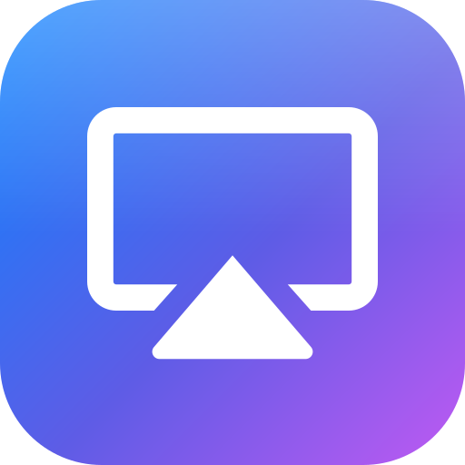
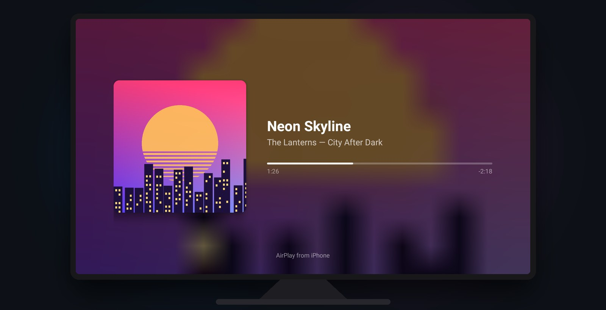
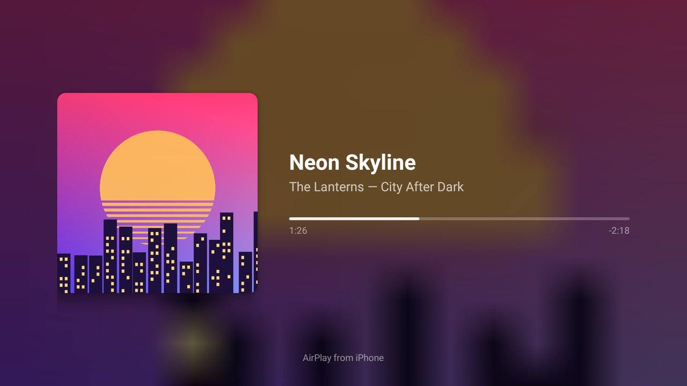
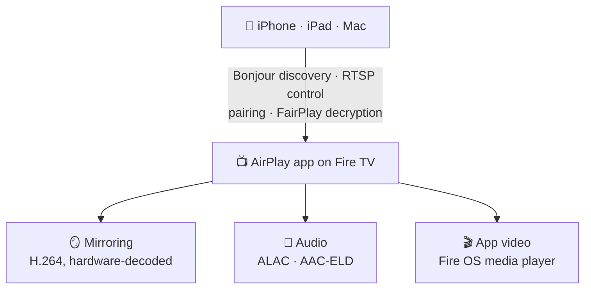

<div align="center">



# AirPlay for Fire TV

**Turn your Amazon Fire TV into an AirPlay receiver.**<br>
Mirror your iPhone, beam videos from apps and play music, without an Apple TV.

[](https://github.com/pri-te-sh/FireTV_AirPlay/releases/latest)
[](https://github.com/pri-te-sh/FireTV_AirPlay/releases)
[](LICENSE)
[](#-install-in-2-minutes)
[](https://github.com/pri-te-sh/FireTV_AirPlay/stargazers)

<a href="https://github.com/pri-te-sh/FireTV_AirPlay/releases/latest/download/AirPlay.apk">
  
</a>

<br><br>



</div>

---

## ✨ Features

<table>
<tr>
<td width="33%" valign="top">

### 📱 Screen Mirroring
Your whole iPhone, iPad or Mac screen on the TV, **with sound**. It's hardware-decoded for low
latency and follows you from portrait to landscape.

</td>
<td width="33%" valign="top">

### 🎬 Video from apps
Tap AirPlay in a video app and **the TV streams the video itself**. Your phone stays a remote:
pause, seek and stop from either side.

</td>
<td width="33%" valign="top">

### 🎵 Music
Lossless AirPlay audio with a **Now Playing** screen: artwork, title, artist, a live progress bar,
and volume from your phone.

</td>
</tr>
<tr>
<td valign="top">

### ⚡ Just works
It shows up in Control Center under your Fire TV's name, starts at boot, and pops up the player the
moment you start AirPlay.

</td>
<td valign="top">

### 🪶 Tiny and light
A **~270 KB** APK using **~60 MB** of memory at rest. No Gradle, no frameworks: plain Java and
Android's own media stack.

</td>
<td valign="top">

### 🔒 Private
No account, no ads, no analytics. Everything stays on your home network, between your phone and
your TV.

</td>
</tr>
</table>

## 📸 Screenshots

<table>
<tr>
<td></td>
<td></td>
</tr>
<tr>
<td align="center"><b>Music</b>: Now Playing with artwork and progress</td>
<td align="center"><b>Video from apps</b>: the TV remote can pause and skip too</td>
</tr>
</table>

## 🚀 Install in 2 minutes

### Option A: on the Fire TV, no computer needed

1. **Allow sideloading.** Go to **Settings → My Fire TV → Developer Options → Install unknown
   apps** and turn it on for **Downloader**.
   > Don't see Developer Options? Go to **Settings → My Fire TV → About** and click your device
   > name 7 times.
2. **Get Downloader** (by AFTVnews) from the Amazon Appstore.
3. **Enter this address** in Downloader and install:
   ```
   https://github.com/pri-te-sh/FireTV_AirPlay/releases/latest/download/AirPlay.apk
   ```
4. **Open AirPlay once.** That's it: from now on it starts by itself whenever the TV boots. 🎉

### Option B: with adb, from a computer

```bash
adb connect <fire-tv-ip>:5555
adb install AirPlay.apk
adb shell appops set com.pritesh.airplay SYSTEM_ALERT_WINDOW allow
```

> 💡 **That last line is worth it.** It lets the player **pop up on its own** the moment you start
> AirPlay. Fire OS has no settings screen for this permission, so it needs adb. Without it,
> everything still works: start AirPlay on your phone, then open the AirPlay app on the TV.

## 🎮 How to use it

| On your iPhone / iPad / Mac | What happens on the TV |
|---|---|
| **Control Center → Screen Mirroring →** your Fire TV | Your screen, with sound |
| **AirPlay button** in Photos, Safari or a video app | The TV plays the video; your phone is the remote |
| **Control Center or Music → AirPlay →** your Fire TV | Music with Now Playing |

**On the Fire TV remote:**
- **Back** stops mirroring or video. On Now Playing, it leaves the music playing.
- **Select / ⏯** pauses and resumes app video.
- **◀ / ▶** skips 10 seconds.

## 🧠 How it works



<details>
<summary><b>Source tour</b></summary>

| Piece | File |
|---|---|
| mDNS (`_airplay._tcp`, `_raop._tcp`) via Android's NsdManager | `Bonjour.java` |
| RTSP control: `/info`, pairing, FairPlay, SETUP/TEARDOWN, volume, metadata | `Receiver.java`, `Rtsp.java` |
| Mirror stream: decrypt (AES-CTR), avcC → Annex-B, hardware H.264 to a Surface | `MirrorStream.java`, `VideoPlayer.java` |
| Audio: RTP/UDP, decrypt (AES-CBC), ALAC (Java) or AAC/AAC-ELD (MediaCodec) → AudioTrack | `AudioStream.java`, `AudioPlayer.java` |
| Video from apps: `/play`, `/rate`, `/scrub`, `/playback-info`, the reverse `/event` channel, YouTube-style `mlhls://` playlists fetched from the phone (FCUP) | `Cast.java`, `Receiver.java` |
| Player screen (mirror / app video / Now Playing) and the app's status screen | `PlayerActivity.java`, `MainActivity.java` |
| Stable identity (pairing key, device id) | `Identity.java` |

</details>

## ❓ FAQ

<details>
<summary><b>My iPhone doesn't see the Fire TV.</b></summary>

- Make sure the phone and the TV are on the **same Wi-Fi network**.
- Open the AirPlay app once after installing, so the receiver starts.
- If the Fire TV runs a **VPN**, exclude this app in the VPN's split-tunneling settings.
- Some guest or mesh networks block device discovery (mDNS). Try the main network.
</details>

<details>
<summary><b>I only get sound from my video app, no picture.</b></summary>

Apps that use their own video player, instead of Apple's standard one, send **sound only** over
AirPlay. Use **Screen Mirroring** for those apps.
</details>

<details>
<summary><b>Can I watch Netflix, Disney+ or Apple TV+?</b></summary>

No. DRM-protected services only AirPlay to Apple-certified devices, and mirroring those apps
usually shows a black screen.
</details>

<details>
<summary><b>Does it need a PIN or password?</b></summary>

No. Anyone on your Wi-Fi can AirPlay to the TV, like an Apple TV set to "Anyone on the Same
Network".
</details>

<details>
<summary><b>Which Fire TV devices work?</b></summary>

Any Fire TV running **Fire OS 7 or newer**. It has been tested on a Fire TV Stick
4K Max (2nd gen, Fire OS 8). Reports from other devices are very welcome. Please
[open an issue](https://github.com/pri-te-sh/FireTV_AirPlay/issues).
</details>

<details>
<summary><b>Which video formats play from apps?</b></summary>

App video uses Fire OS's built-in player. MP4 and standard HLS streams are tested; other formats
depend on what Fire OS supports.
</details>

## 🛠️ Build from source

No Gradle, no Android Studio. `build.sh` runs aapt2 → javac → d8 → zipalign → apksigner directly.

**You need:**
- an Android SDK with a platform and build-tools;
- JDK 11 or newer;
- macOS or Linux with zsh.

```bash
git clone https://github.com/pri-te-sh/FireTV_AirPlay.git && cd FireTV_AirPlay
ANDROID_SDK=~/Library/Android/sdk ./build.sh        # → build/AirPlay.apk
FIRETV=192.168.1.20:5555 ./build.sh --install       # build, install, grant, open
```

Optional settings: `BUILD_TOOLS` (version) and `PLATFORM` (default `android-33`).

The first build creates `keystore.jks` to sign the APK. It's git-ignored. Keep it, because
Android only installs updates signed with the same key. `KEYSTORE` / `KEYSTORE_PASS` point the
build at your own key.

## 🤝 Contributing

Issues and pull requests are welcome! Good places to start:

- 🧪 **Test reports** from other Fire TV models and iOS versions
- 🎞️ **HEVC (H.265) mirroring** for sharper picture at the same bandwidth
- 🎚️ **Audio/video sync** and packet retransmission for flaky Wi-Fi
- 🔐 **Optional PIN pairing**
- ✏️ **Renaming the receiver** from the TV

If you hit a bug, please include your Fire TV model, Fire OS version, iOS version and the output of
`adb logcat -s AirPlay`.

## 🙏 Credits

This project stands on the shoulders of:

- **[java-airplay](https://github.com/serezhka/java-airplay)** by Sergei Fedorov (MIT): FairPlay and
  pairing, ported to Android in `third_party/com/github/serezhka`.
- **[Java ALAC decoder](https://github.com/soiaf/Java-Apple-Lossless-decoder)** by Peter McQuillan
  (BSD): Apple Lossless decoding, since Fire OS has no ALAC codec.
- **[Bouncy Castle](https://www.bouncycastle.org)** (MIT): X25519 key agreement.
- **[dd-plist](https://github.com/3breadt/dd-plist)** (MIT) and
  **[ed25519-java](https://github.com/str4d/ed25519-java)** (CC0).

License texts are in [`third_party/`](third_party).

## 📄 License

[MIT](LICENSE) © 2026 Pritesh Bhavsar

<sub>AirPlay, iPhone, iPad and Mac are trademarks of Apple Inc. Fire TV is a trademark of Amazon.com,
Inc. This project isn't affiliated with or endorsed by Apple or Amazon.</sub>

<div align="center">

**If this saved you from buying an Apple TV, give it a ⭐!**

</div>
